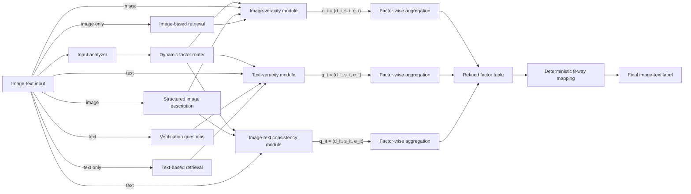

# Source-Aware Multimodal Disinformation Verification

Companion implementation for **Source-Aware Multimodal Disinformation Verification via Modality-Level Veracity and Cross-Modal Consistency**.

> Manuscript status: **revision/pre-publication artifact**. The repository is aligned to the frozen main-manuscript method, evaluation protocols, and Tables III-VI. Exact upstream model/evidence artifacts remain subject to the reproducibility notes below.

[Method](#method) · [Installation](#installation) · [Data](#data) · [Zero-shot inference](#zero-shot-inference) · [Fine-tuning](#factor-level-fine-tuning) · [Results](#reported-results) · [Paper alignment](docs/PAPER_ALIGNMENT.md)

## What belongs here

This repository contains the **journal-extension verification code**: modality analysis, dynamic routing, factor-level validation, evidence interfaces, structured aggregation, task-specific factor-instance generation, evaluation, and paper-aligned experiment records.

OctantFake construction and release tooling remain in the separate [WWW repository](https://github.com/SaiSyokan/8way-multimodal-disinformation). The gated dataset is hosted at [Syokan/OctantFake](https://huggingface.co/datasets/Syokan/OctantFake). Dataset media, third-party model weights, credentials, and copyrighted web evidence are intentionally not duplicated here.

## Method

For an input with available modalities \(M_X\), the analyzer builds the pairwise relation set \(R_X\). The router activates

$$
F_X = \{v_m \mid m \in M_X\} \cup \{c_{mn} \mid (m,n) \in R_X\}.
$$

Each active validator returns a decision, confidence, and evidence-grounded explanation. In the proposed method, each factor is then independently refined using only its own structured output before the final factor tuple is deterministically mapped to the image-text label. The diagram below shows the evaluated image-text instantiation: image-based and text-based retrieval remain separated, verification questions are generated only from the text, and the consistency branch does not consume external evidence.



The released implementation supports image-only, text-only, and image-text routing paths for code-level validation. The manuscript experiments evaluate the image-text instantiation. The general formulation permits additional modalities, but audio/video validators were not evaluated and are therefore not presented as implemented results.

## Installation

Python 3.10 or later is required. The core install has no model or network dependency:

```bash
git clone https://github.com/SaiSyokan/fine-grained-multimodal-verification.git
cd fine-grained-multimodal-verification
python -m venv .venv
source .venv/bin/activate
python -m pip install --upgrade pip
python -m pip install -e .
python -m unittest discover -s tests -v
```

Install optional components only when needed:

```bash
python -m pip install -e '.[evidence,inference]'
```

LLaVA is not vendored. Install a compatible upstream LLaVA implementation before selecting the LLaVA backend. See [installation and environment notes](docs/INSTALLATION.md).

## Data

Request access to [OctantFake on Hugging Face](https://huggingface.co/datasets/Syokan/OctantFake), accept its terms, authenticate, and download the complete snapshot. The official zero-shot protocol uses:

| Split | Samples | Purpose |
|---|---:|---|
| Development (official calibration split) | 800 | Prompt development, design selection, and retrieval-budget selection |
| Test | 8,000 | Final zero-shot evaluation |

The supervised protocol uses the original 800-sample calibration split as validation and stratifies the original test split into 7,200 training and 800 held-out test samples (900/100 per class). See [data protocol](docs/DATA.md).

Validate a local manifest:

```bash
sourceaware validate /path/to/manifest.jsonl --check-files --media-root /path/to/OctantFake
```

## Evidence collection

Use `.env.example` as a credential checklist and export the variables through your shell or secret manager. The image query uses only the image; the text query uses only the original text. Verification questions guide reasoning but do not alter the search query.

```bash
sourceaware collect-image-evidence --manifest manifest.jsonl --output evidence --limit 3 --media-root /path/to/OctantFake
sourceaware collect-text-evidence --manifest manifest.jsonl --output evidence --limit 3
```

Evidence is timestamped and should be treated as a time-sensitive run artifact. Raw evidence is ignored by Git to avoid accidental redistribution.

## Zero-shot inference

The primary paper configuration performs separate factor checks followed by structured aggregation:

```bash
sourceaware run \
  --manifest manifest.jsonl \
  --media-root /path/to/OctantFake \
  --evidence-root evidence \
  --model-path /path/to/llava-v1.6-34b \
  --strategy separate_structured \
  --output predictions.jsonl

sourceaware evaluate predictions.jsonl --output metrics.json
sourceaware evaluate-factors predictions.jsonl --output factor-metrics.json
```

The five framework-ablation strategies are `holistic` (A), `joint_factors` (B), `separate_deterministic` (C), `separate_structured` (D, proposed), and `separate_cross_factor` (E). Module ablations use `--no-evidence`, `--no-image-description`, and `--retrieval-limit {0,1,2,3,4,5}`. `k=0` is distinct from `--no-evidence`: it retains the evidence-enabled verification path but provides zero retrieved evidence instances.

## Factor-level fine-tuning

Each labeled image-text pair produces three supervision instances, one per factor:

```bash
sourceaware prepare-finetune \
  --manifest train.jsonl \
  --output train.factor-instances.jsonl
```

The frozen main manuscript specifies a shared LLaVA-1.6-34B backbone, LoRA adaptation, a frozen vision encoder, factor-level supervision, and checkpoint selection by validation macro-F1. External retrieval is not used during fine-tuning. Additional training values carried by this pre-publication artifact must be checked against the original training command/log before they are treated as archival settings; see [training protocol](docs/TRAINING.md).

## Reported results

Machine-readable transcriptions of manuscript Tables III-VI are in [`results/`](results/README.md). They are reference records, not regenerated claims. Raw per-sample predictions and model checkpoints must come from the original experiment runs and are not fabricated by this package.

## Repository layout

```text
.
├── configs/                 # Paper-aligned inference/training settings
├── docs/                    # Method, prompts, data, baselines, and paper alignment
├── examples/                # Synthetic, non-benchmark examples
├── results/                 # Manuscript table transcriptions
├── src/sourceaware_verification/
│   ├── routing.py           # Analyzer and F_X construction
│   ├── prompts.py           # Exact validator and aggregation prompts
│   ├── evidence.py          # Google retrieval adapters and evidence store
│   ├── pipeline.py          # Factor modules and aggregation
│   ├── finetune.py          # Factor-specific supervision conversion
│   └── evaluation.py        # 8-way and factor-level metrics
└── tests/                   # Offline tests; no keys, media, or model required
```

## Responsible use

Outputs are evidence-budget-dependent verification decisions, not guarantees of truth. A `T` decision means that no violation was detected under the available evidence and fixed verification setting. Review the dataset terms and [third-party notice](THIRD_PARTY.md) before use.

## License

Code in this repository is released under the MIT License. This license does not apply to OctantFake media, third-party datasets, model weights, or retrieved web content.
